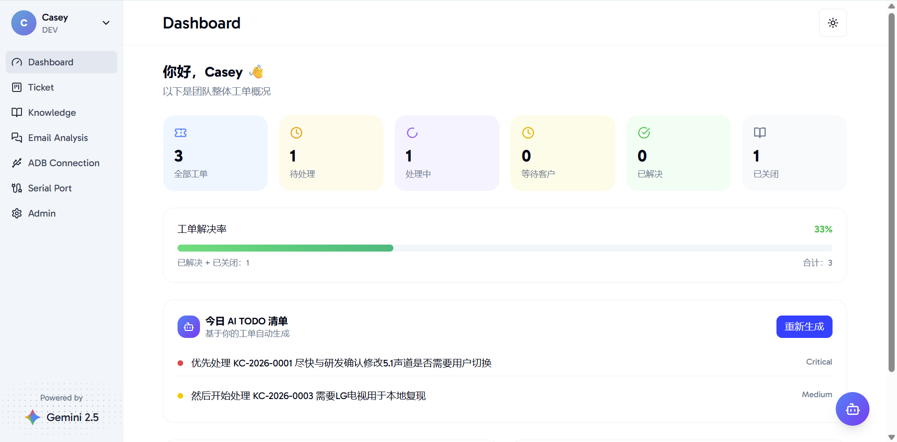
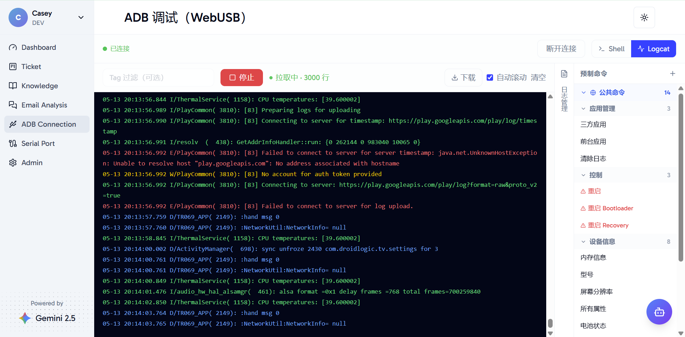

# Friendly AI Explorer

English · [简体中文](README.md)

A workspace for FAE technical support teams: ticket management, a knowledge base with RAG, work email, AI workflows, and WebUSB / Serial device debugging.

The interface supports English and Simplified Chinese. The browser's preferred language determines the default, with English as the fallback. Manual selections use a session cookie. Newly generated AI content follows the interface language; original business content and saved generations are preserved.

## Technology

- Frontend: Next.js 15, React, TypeScript, Tailwind CSS 4, shadcn/ui.
- Backend: Python 3.11, FastAPI, SQLAlchemy, and a separate workbench worker.
- Database: PostgreSQL 16 + pgvector.
- Deployment: Docker Compose and Nginx; the frontend runs on Node.js 22.

## Local startup

Install Docker Engine / Docker Desktop with Docker Compose. From the repository root:

```sh
cp .env.example .env
```

In Windows PowerShell, use `Copy-Item .env.example .env`. Set three independent random secrets: `DB_PASSWORD`, `APP_MASTER_KEY`, and `AUTH_SECRET`. Then run:

```sh
docker compose -f docker-compose.yml up -d --build
```

Open the [local application](http://localhost:3000). An empty database initializes from `db/init.sql`; startup does not rebuild an existing database. The initial account is `dev@kaicheng.me` with password `123456`. Change the password after signing in and configure your AI services.

## Operation

- [Production deployment and configuration](docs/deployment.md)
- [Release history](docs/releases/CHANGELOG.md)
- [Database initialization](db/README.md)

## Screenshots




## Attribution and license

The frontend originated from [visactor-next-template](https://github.com/mengxi-ream/visactor-next-template). Its original license remains in [frontend/LICENSE](frontend/LICENSE). See [LICENSE](LICENSE) for the project license.
